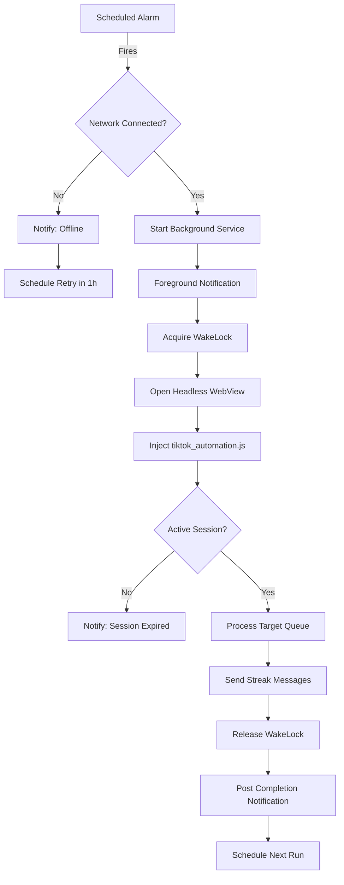

<h1 align="center">🔥 TikTok AutoStreak</h1>

<strong>Sleek Obsidian Streak Automation for Android — Created for Mrblack</strong>

TikTok AutoStreak automatically sends TikTok messages to keep your streaks alive natively in the background, featuring an OLED-friendly Obsidian Dark Mode, radial neon arc progress gauges, partner management, and activity telemetry.

---

## ✨ Features

- **🕐 Automatic Scheduling** — Hours-only run interval (1–23 h, default 23 h)
- **👥 Multiple Friends** — Add, edit, import, and export your streak list
- **📱 Background Service** — Runs even when the app is closed
- **🔔 Smart Notifications** — Foreground progress notification while sending; separate completion / offline alert
- **🌐 Offline Resilience** — If the device has no Wi-Fi or mobile data when an alarm fires, the run is skipped, the user is notified, and a retry is automatically scheduled in 1 hour (no streak slot wasted)
- **🔄 Boot Persistence** — Automatically reschedules the next run after device restart
- **🔐 Cookie-Based Session** — Login once via WebView; the captured user agent is reused for every background run so cookies stay valid
- **⚡ Battery Optimized** — Requests battery-optimization exemption for reliable background execution
- **🎲 Randomized Messages** — Optional pool of 50 short built-in streak variants ("streak", "yo streak", "hey", …) so you don't always send the same text
- **🧭 Skip Unreachable** — Optional behavior (on by default for new installs) to continue with other friends when a chat cannot be opened
- **🗂 Multi-Page UI** — Dashboard, Friends, History, and Profile pages with a custom floating nav bar
- **📊 Run History & Stats** — Per-run success rate, last-run summary, and exportable run logs
- **📦 In-App Updates** — Check for updates from the app; downloaded APKs install via the system installer (FileProvider on Android)
- **🔄 Up-to-Date Automation** — TikTok WebView automation script maintained for current inbox behavior

## 📋 Requirements

- **Android:** 7.0 (API 24) or higher — **recommended for daily streak protection**
- **iOS:** 17.0 or higher — **experimental only**; see [iOS limitations](docs/ios-limitations.md)
- TikTok account
- Internet connection

## 📥 Installation

### Option 1: Download APK (Recommended)

1. Go to the [Releases](../../releases) page
2. Download the latest `TikTok-AutoStreak-vX.X.X.apk`
3. Enable "Install from unknown sources" on your Android device
4. Install the APK

### iOS (AltStore) — experimental, not recommended

> **Do not rely on iOS for streak protection today.** The iPhone build is best-effort only: automations fail on a locked phone, WebView automation cannot run silently in the background, and AltStore certificates expire every ~7 days. **[Read why → docs/ios-limitations.md](docs/ios-limitations.md)**

For testing only:
1. Download `TikTokStreakSaver.ipa` from the latest release
2. Install via AltStore, SideStore, or TrollStore
3. Complete the in-app iOS setup wizard

---

## 🛠 Automation Details

### How It Works

---

## ⚠️ Disclaimer

This app is for educational purposes only. Use responsibly and in accordance with TikTok's Terms of Service. The developers are not responsible for any account restrictions or bans that may result from using this application.

## 🔒 Privacy

TikTok AutoStreak does not collect, transmit, sell, or share any personal data. There are no analytics, no advertising, no third-party tracking SDKs, and no developer-owned servers — everything you configure stays on your device. See the full policy in [PRIVACY.md](PRIVACY.md).

## 📄 License

This project is licensed under the MIT License — see the [LICENSE](LICENSE) file for details.

---

  <strong>TikTok AutoStreak by Mrblack</strong> • Obsidian Edition

